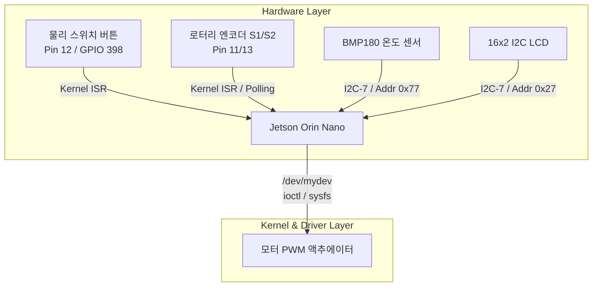
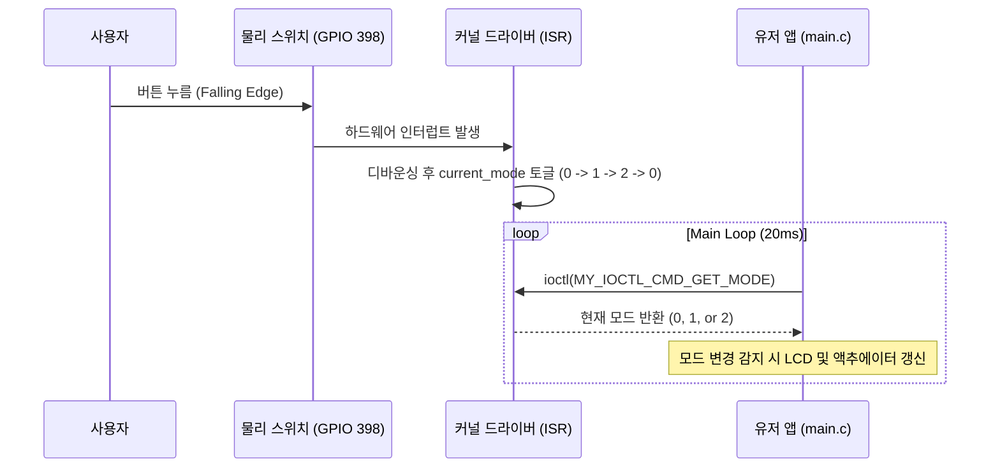

# 멀티모드 모터 PWM 및 센서 통합 제어 시스템 상위 설계서 v1.0

> **Multi-Mode Motor PWM & Sensor Integrated Control System — High-Level Design Document**

---

## 1. 개요 및 목표

### 1-1 주제
본 시스템은 **Jetson Orin Nano (Tegra234)** 임베디드 리눅스 환경을 기반으로, 커널 드라이버 인터럽트, `ioctl` 통신, I2C 주변장치(BMP180 온도 센서, I2C LCD), 그리고 Sysfs PWM을 통합하여 **로터리 엔코더 수동 제어, 온도 기반 자동 제어, 그리고 모드 토글 스위치** 기능을 실시간으로 수행하는 멀티모드 모터 제어 시스템이다.

### 1-2 핵심 목표
* **실시간 하드웨어 입력 연동**: 물리 버튼 및 로터리 엔코더 입력을 커널 레벨 인터럽트와 동기화하여 파일 I/O 지연 최소화
* **멀티모드 제어 아키텍처**: 시스템 운영 모드를 수동(Encoder), 자동(Temp Control), 정지(Stop)의 3가지 상태로 분기하여 유연한 제어 수행
* **환경 센서 및 디스플레이 실시간 갱신**: I2C 기반의 고속 온도 측정(0.2초 주기) 및 8단계 선형 매핑을 통한 모터 속도 자동 조절, I2C LCD 실시간 출력
* **안정적인 사용자 인터페이스**: 표준 출력 버퍼링 제거(`setbuf(stdout, NULL)`)를 통한 터미널 실시간 모니터링 확보

---

## 2. 시스템 아키텍처 및 구성

### 2-1 전체 시스템 구성도 (Mermaid Architecture)

### 2-2 모듈별 역할 및 책임 (Component Breakdown)

| 파일 명칭 | 계층 및 역할 | 주요 구현 내용 |
| --- | --- | --- |
| **`main.c`** | Application | 시스템 메인 루프, 상태 머신(FSM) 관리, 주기적 센서 측정 및 모드별 제어 분기 |
| **`my_ioctl.h`** | Interface / Protocol | 커널-유저 간 통신용 Magic Number 및 `ioctl` 커맨드 매크로 정의 (`SET_SPEED`, `GET_SPEED`, `GET_COUNT`, `GET_MODE`) |
| **`switch.c` / `.h`** | Driver Interface | `ioctl`을 통해 커널 드라이버로부터 현재 토글된 모드 상태(`get_current_mode`)를 획득 |
| **`motor.c` / `.h`** | Actuator Driver | Sysfs PWM(`/sys/class/pwm/.../duty_cycle`) 인터페이스를 이용한 모터 듀티비 제어 |
| **`bmp180.c` / `.h`** | Sensor Driver (I2C) | I2C-7 버스를 통한 BMP180 캘리브레이션 데이터 로드 및 비동기 온도($T$) 측정 |
| **`lcd.c` / `.h`** | Display Driver (I2C) | 16x2 I2C LCD(PCF8574, Address `0x27`) 초기화 및 4비트 데이터 전송 명령어 처리 |

---

## 3. 인터페이스 및 프로토콜 정의

### 3-1 I2C 디바이스 주소 및 인터페이스
* **I2C Bus**: `/dev/i2c-7` (Jetson I2C 채널)
* **I2C LCD**: 주소 `0x27`, 백라이트 제어 및 4비트 모드 구동
* **BMP180 센서**: 주소 `0x77`, Uncompensated Temperature(UT) 측정 및 보정 공식 적용

### 3-2 `ioctl` 커맨드 명세 (`my_ioctl.h`)

| 커맨드 매크로 | 타입 / 번호 | 방향 (`_IOR` / `_IOW`) | 설명 |
| --- | --- | --- | --- |
| `MY_IOCTL_CMD_SET_SPEED` | `'k', 1` | `_IOW` (Write) | 모터 PWM 속도 퍼센트(0~100) 설정 |
| `MY_IOCTL_CMD_GET_SPEED` | `'k', 2` | `_IOR` (Read) | 현재 모터 PWM 속도 퍼센트 조회 |
| `MY_IOCTL_CMD_GET_COUNT` | `'k', 3` | `_IOR` (Read) | 로터리 엔코더 누적 펄스 카운트 조회 |
| `MY_IOCTL_CMD_GET_MODE` | `'k', 4` | `_IOR` (Read) | 커널 인터럽트로 관리되는 스위치 모드 조회 (0, 1, 2) |

---

## 4. 운영 모드 및 제어 시나리오

### 4.1 시스템 동작 모드 순환 흐름 (Mermaid Sequence)

### 4.2 모드별 상세 제어 시나리오

| 모드 번호 | 모드 명칭 | 제어 주체 및 동작 설명 |
| --- | --- | --- |
| **Mode 0** | `MODE_ENCODER_SPEED` | 수동 제어 모드: 로터리 엔코더 조작에 따른 카운트 및 속도 값을 `ioctl`로 가져와 Sysfs PWM에 반영하고 LCD 첫/두 번째 줄에 출력 |
| **Mode 1** | `MODE_TEMP_CONTROL` | 온도 기반 자동 제어 모드: 0.2초 주기로 BMP180 온도를 측정하고, $20^\circ\text{C} \sim 35^\circ\text{C}$ 구간을 8단계로 분할하여 매핑된 속도 백분율로 모터 자동 구동 |
| **Mode 2** | `MODE_MOTOR_STOP` | 비상 정지 모드: 모터 속도를 강제로 `0%`로 고정하고 LCD에 정지 상태 표시 |

### 4.3 온도-속도 8단계 선형 매핑 알고리즘
* **제한 범위**: $20^\circ\text{C}$ 이하 시 `0%`, $35^\circ\text{C}$ 이상 시 `100%`
* **단계별 테이블**: 
  $$\text{Step Size} = \frac{35.0 - 20.0}{8} = 1.875^\circ\text{C}$$
  $$\text{Speed Steps} = \{0, 14, 28, 42, 57, 71, 85, 100\}\%$$

---

## 5. 예외 처리 및 성능 최적화

* **실시간 터미널 출력 보장**: 루프 시작 시 `setbuf(stdout, NULL);`을 선언하여 표준 출력 버퍼링으로 인한 로그 지연 현상 원천 차단
* **비동기 인터럽트 통신**: 커널 공간에서 하드웨어 스위치 및 엔코더 인터럽트를 전담 처리하므로 폴링 부하가 적고 반응 속도가 즉각적임
* **I2C 예외 방어**: 디바이스 오픈 실패 및 I2C 통신 오류 시 `perror` 메시지 출력 후 안전하게 프로세스 종료 (`EXIT_FAILURE`)